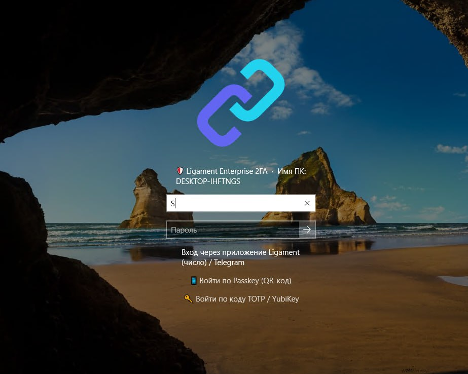
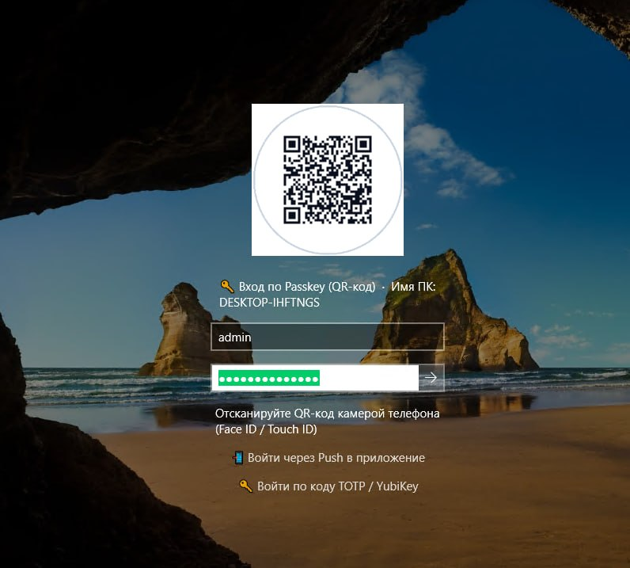
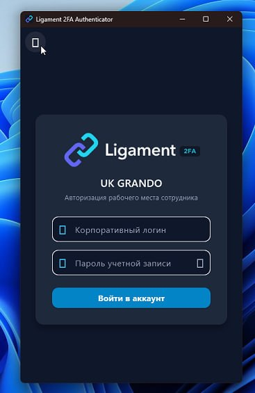

# 📚 Руководство по установке и первоначальной настройке Ligament 2FA

Официальное техническое руководство по развёртыванию и конфигурированию On-Premise платформы многофакторной аутентификации **Ligament** в корпоративной инфраструктуре.

---

## 📑 Содержание

1. [Архитектура и системные требования](#1-архитектура-и-системные-требования)
2. [Способы установки сервера Ligament Core](#2-способы-установки-сервера-ligament-core)
   - [Вариант А: Автоматический скрипт одной командой (Рекомендуется)](#вариант-а-автоматический-скрипт-одной-командой-рекомендуется)
   - [Вариант Б: Ручной запуск через Docker Compose](#вариант-б-ручной-запуск-через-docker-compose)
3. [Первый вход администратора и безопасность](#3-первый-вход-администратора-и-безопасность)
4. [Активация лицензии и квоты пользователей](#4-активация-лицензии-и-квоты-пользователей)
5. [Настройка домена и SSL/TLS](#5-настройка-домена-и-ssltls)
6. [Интеграция с Active Directory и FreeIPA](#6-интеграция-с-active-directory-и-freeipa)
7. [Настройка каналов доставки второго фактора (MFA)](#7-настройка-каналов-доставки-второго-фактора-mfa)
8. [Настройка RADIUS (MikroTik RouterOS, VPN, Wi-Fi 802.1X)](#8-настройка-radius-mikrotik-routeros-vpn-wi-fi-8021x)
9. [Развёртывание агентов Windows Logon & RDP (MSI + GPO)](#9-развёртывание-агентов-windows-logon--rdp-msi--gpo)
10. [Подключение сотрудников и мобильных клиентов](#10-подключение-сотрудников-и-мобильных-клиентов)
11. [Развёртывание узлов Ligament Relay в филиалах](#11-развёртывание-узлов-ligament-relay-в-филиалах)
12. [Диагностика, мониторинг и резервное копирование](#12-диагностика-мониторинг-и-резервное-копирование)

---

## 1. Архитектура и системные требования

Ligament функционирует полностью автономно внутри вашего периметра (**100% On-Premise**). Все ключи, хэши, учётные записи и журналы безопасности остаются в вашей базе данных PostgreSQL.

### Минимальные аппаратные требования
- **CPU**: 1 виртуальное или физическое ядро (x86_64 или ARM64).
- **RAM**: 1 ГБ (рекомендуется 2 ГБ для нагрузок от 500 активных пользователей).
- **Диск**: 10 ГБ свободного места на SSD (для ОС, Docker-образов и базы PostgreSQL).
- **Поддерживаемые ОС**: Любой современный Linux дистрибутив:
  - Astra Linux (Special Edition 1.7 / Common Edition)
  - РЕД ОС 7.3 / 8
  - Альт Сервер / СПТ (p9, p10)
  - Ubuntu Server 20.04 / 22.04 / 24.04 LTS
  - Debian 11 / 12
  - Rocky Linux / AlmaLinux / RHEL 8 / 9

### Сетевые порты
| Порт | Протокол | Назначение | Доступность |
|---|---|---|---|
| **80** | TCP | HTTP-перенаправление и ACME HTTP-01 challenge | Внешний / Внутренний |
| **8080** | TCP | Web-интерфейс администратора, кабинет пользователя, REST API, WebSSO | Внутренний (или через Reverse Proxy) |
| **443** | TCP | Защищённый HTTPS/WSS (при использовании внешнего Reverse Proxy или встроенного TLS) | Рабочие станции, мобильные клиенты, релеи |
| **1812** | UDP | RADIUS Authentication (аутентификация MikroTik, VPN, Wi-Fi 802.1X) | Сетевые шлюзы, точки доступа, VPN-серверы |
| **1813** | UDP | RADIUS Accounting (учёт времени сессий и трафика) | Сетевые шлюзы |

---

## 2. Способы установки сервера Ligament Core

### Вариант А: Автоматический скрипт одной командой (Рекомендуется)

Установочный скрипт автоматически:
1. Проверяет наличие Docker и плагина Docker Compose v2.
2. Тестирует свободность необходимых TCP и UDP портов.
3. Генерирует надёжный криптографический пароль PostgreSQL и сохраняет его в файл `.env` с правами доступа `0600`.
4. Загружает официальный образ `aligorov/ligament_2fa:latest` из Docker Hub.
5. Запускает контейнеры базы данных и ядра, ожидает успешного прохождения проверки `/healthz`.
6. Выгружает первичный пароль администратора `admin_password.txt` и коды восстановления `admin_recovery_codes.txt`.

Выполните на сервере:

```bash
mkdir -p /opt/ligament && cd /opt/ligament
curl -fsSL https://raw.githubusercontent.com/aligorov/ligament/main/install.sh -o install.sh
chmod +x install.sh && ./install.sh
```

#### Дополнительные полезные флаги инсталлятора:
```bash
./install.sh --http-port 8080      # Использовать порт 8080 вместо привилегированного 80
./install.sh --tag v1.1.15         # Зафиксировать релизную версию контейнера
./install.sh --set-password '...'  # Задать свой пароль для PostgreSQL
./install.sh --fresh               # Очистить данные старой установки при переустановке
```

---

### Вариант Б: Ручной запуск через Docker Compose

Если вы предпочитаете ручное управление инфраструктурой:

1. Создайте рабочий каталог:
```bash
mkdir -p /opt/ligament && cd /opt/ligament
```

2. Создайте файл `docker-compose.yml`:
```yaml
services:
  db:
    image: postgres:16-alpine
    environment:
      POSTGRES_USER: twofa
      POSTGRES_PASSWORD: "${TWOFA_PG_PASSWORD:?Ошибка: укажите TWOFA_PG_PASSWORD в .env}"
      POSTGRES_DB: twofa
    volumes:
      - twofa_pgdata:/var/lib/postgresql/data
    healthcheck:
      test: ["CMD-SHELL", "pg_isready -U twofa -d twofa"]
      interval: 5s
      timeout: 3s
      retries: 20
    restart: unless-stopped

  twofa:
    image: aligorov/ligament_2fa:${TWOFA_IMAGE_TAG:-latest}
    hostname: ligament-auth
    depends_on:
      db:
        condition: service_healthy
    environment:
      TWOFA_DB_DSN: "postgres://twofa:${TWOFA_PG_PASSWORD}@db:5432/twofa"
      TRUSTED_PROXIES: "127.0.0.0/8,::1/128,172.16.0.0/12,10.0.0.0/8,192.168.0.0/16"
    ports:
      - "80:8080"
      - "8080:8080"
      - "1812:1812/udp"
      - "1813:1813/udp"
    volumes:
      # Для аппаратной привязки лицензии к физическому хосту Linux (read-only):
      - /etc/machine-id:/etc/host-machine-id:ro
    restart: unless-stopped

volumes:
  twofa_pgdata:
```

3. Сгенерируйте файл `.env`:
```bash
echo "TWOFA_PG_PASSWORD=$(openssl rand -hex 24)" > .env
chmod 600 .env
```

4. Запустите контейнеры:
```bash
docker compose pull
docker compose up -d
```

5. Извлеките первичный пароль администратора и коды аварийного восстановления:
```bash
docker cp $(docker compose ps -q twofa):/home/nonroot/admin_password.txt .
docker cp $(docker compose ps -q twofa):/home/nonroot/admin_recovery_codes.txt .
chmod 600 admin_password.txt admin_recovery_codes.txt
cat admin_password.txt
```

---

## 3. Первый вход администратора и безопасность

1. Откройте в браузере: `http://<IP-адрес-вашего-сервера>:8080` (или порт 80).
2. Авторизуйтесь:
   - **Имя пользователя**: `admin`
   - **Пароль**: значение из файла `admin_password.txt`.
3. Сохраните содержимое файла `admin_recovery_codes.txt` (5 одноразовых кодов break-glass) в корпоративный менеджер паролей или физический сейф.
4. **Удалите файл пароля с сервера**:
```bash
rm -f /opt/ligament/admin_password.txt
```
5. Перейдите в профиль учётной записи `admin`, измените пароль на постоянный и **активируйте двухфакторную аутентификацию** (TOTP через Google Authenticator / Яндекс.Ключ либо Telegram-бот).

---

## 4. Активация лицензии и квоты пользователей

По умолчанию сервер запускается в редакции **Community** (до 5 активных пользователей навсегда бесплатно).

Для расширения числа пользователей или включения коммерческих модулей (SSO OpenID/SAML, Windows Logon UAC Elevation, Branch Relay, Бастион):
1. Откройте веб-панель: **/admin → Лицензия**.
2. Вставьте лицензионный ключ (текст в формате Base64 с цифровой подписью Ed25519) в поле ввода.
3. Нажмите кнопку **«Сохранить лицензию»**.
4. Лицензия валидируется математически на месте: она вступает в силу **моментально**, не требует перезапуска контейнера и не требует выхода в интернет (полная совместимость с закрытыми контурами Air-Gapped).

---

## 5. Настройка домена и SSL/TLS

Все ссылки подтверждения, перенаправления Single Sign-On и регистрация WebAuthn / Passkeys требуют указания корректного внешнего домена.

В разделе **/admin → Настройки → Домен и шаблоны**:
- Задайте ключ `server.domain`:
  ```
  https://auth.company.corp
  ```

### Варианты обеспечения HTTPS:

#### Вариант 1: Корпоративный Reverse Proxy (Nginx / Caddy / Traefik / HAProxy)
Рекомендуемый подход. Ligament принимает трафик по HTTP (порт 8080), а SSL-сертификаты терминируются на внешнем балансировщике.
Убедитесь, что ваш прокси передаёт заголовки `X-Forwarded-For` и `X-Forwarded-Proto: https`, а его подсеть входит в переменную окружения `TRUSTED_PROXIES`.

#### Вариант 2: Встроенный ACME (Let's Encrypt)
Если сервер доступен из интернета по порту 80/443, Ligament может автоматически заказывать и продлевать сертификаты:
- В разделе **/admin → Настройки → SSL/TLS**:
  - `acme.domain`: `auth.company.com`
  - `acme.email`: `security@company.com`

---

## 6. Интеграция с Active Directory и FreeIPA

Ligament поддерживает импорт и сквозную аутентификацию пользователей по протоколу LDAPS.

Перейдите в **/admin → Настройки → Служба каталогов (LDAP)**:

| Параметр | Пример значения | Описание |
|---|---|---|
| **Включить LDAP** | `true` | Активация модуля интеграции |
| **URL сервера** | `ldaps://dc1.company.corp:636` | Рекомендуется защищённый LDAPS |
| **StartTLS** | `false` (при ldaps) или `true` (при ldap://:389) | Шифрование сессии |
| **Bind DN** | `CN=svc-ligament,OU=Services,DC=company,DC=corp` | Сервисная учётка для поиска |
| **Bind Password** | `••••••••••••` | Пароль сервисной учётки |
| **Base DN** | `DC=company,DC=corp` | Корень дерева каталога |
| **User Filter** | `(&(objectCategory=person)(objectClass=user)(sAMAccountName={login}))` | Шаблон поиска пользователя |
| **Кэшировать пароли** | `true` | Критично для Wi-Fi 802.1X PEAP/MS-CHAPv2 |

> [!TIP]
> Опция **«Кэшировать доменные пароли»** шифрует подтверждённый пароль мастер-ключом сервера и сохраняет его в защищённом поле базы. Это позволяет корпоративным точкам доступа авторизовывать сотрудников в Wi-Fi сети (WPA2/WPA3 Enterprise 802.1X PEAP), не требуя раскрытия паролей контроллера домена в открытом виде.

---

## 7. Настройка каналов доставки второго фактора (MFA)

В разделе **/admin → Настройки** вы можете настроить любые удобные каналы доставки:

### 1. Telegram-бот (Push с подтверждением в один клик)
1. Откройте в Telegram диалог с `@BotFather` и выполните команду `/newbot`.
2. Скопируйте полученный API-токен (например, `7123456789:AAH...`).
3. В Ligament перейдите в **/admin → Настройки → Telegram** и вставьте токен в поле `telegram.bot_token`.
4. Сотрудники привязывают бота в своём кабинете пользователя либо сканируя QR-код с экрана.

### 2. Корпоративный почтовый сервер (SMTP)
В разделе **/admin → Настройки → SMTP**:
```json
{
  "host": "mail.company.corp",
  "port": 587,
  "starttls": true,
  "user": "ligament-auth@company.corp",
  "password": "PasswordHere",
  "from": "ligament-auth@company.corp",
  "subject": "Код подтверждения входа"
}
```

### 3. SMS-шлюзы и Голосовая доставка (TTS)
Поддерживаются прямые пресеты: SMS.RU, SMS-Центр (smsc.ru), Devino Telecom, МегаФон Таргет, а также шлюзы SMPP и локальные GSM-модемы через AT-команды.

### 4. FIDO2 / Passkeys / WebAuthn
Включите поддержку аппаратных токенов (Рутокен MFA, YubiKey) и встроенных биометрических датчиков (Windows Hello, Touch ID). Все ключи работают напрямую в браузере по стандартам FIDO Alliance.

---

## 8. Настройка RADIUS (MikroTik RouterOS, VPN, Wi-Fi 802.1X)

Ligament включает высокопроизводительный встроенный сервер RADIUS (RFC 2865 / RFC 2866).

### 1. Конфигурация в Ligament:
- В **/admin → Настройки → RADIUS**:
  - `radius.secret`: задайте общий секрет (например, `K9s#mP2$xL9!vB4`).

### 2. Подключение MikroTik RouterOS:
Выполните в терминале MikroTik WinBox или SSH:

```routeros
# Добавление RADIUS сервера Ligament
/radius add address=192.168.1.10 secret="K9s#mP2$xL9!vB4" service=login,ppp,wireless timeout=5s

# Включение RADIUS для локального входа администраторов в RouterOS
/user aaa set use-radius=yes

# Включение RADIUS для VPN-серверов (L2TP/SSTP/PPTP/OVPN)
/ppp aaa set use-radius=yes accounting=yes

# Включение входящих CoA/Disconnect запросов
/radius incoming set accept=yes
```

При подключении пользователя MikroTik запрашивает у Ligament подтверждение. Сотрудник получает Push-уведомление на смартфон (с контрольным числом Number Matching) или подтверждает вход через Telegram-бота.

---

## 9. Развёртывание агентов Windows Logon & RDP (MSI + GPO)

Для защиты локального входа на рабочие станции и удалённых терминальных RDP-сессий используется нативный модуль **Credential Provider**.

### Интерфейс входа Windows LogonUI



*Рис. 1: Нативный экран входа Windows LogonUI — сотрудник вводит доменный пароль и выбирает фактор подтверждения (Push, Telegram, Passkey или TOTP).*



*Рис. 2: Вход по Passkey — сотрудник сканирует динамический QR-код на экране монитора камерой смартфона для мгновенной биометрической авторизации Face ID / Touch ID.*

### 1. Загрузка дистрибутива:
Скачайте актуальный пакет с официального репозитория:
- Инсталлятор: `Ligament-2FA-Windows-x64.msi`
- Административные шаблоны: `Ligament2FA.admx` и языковой файл `Ligament2FA.adml`

### 2. Установка административного шаблона GPO:
1. Скопируйте файл `Ligament2FA.admx` в:
   `\\yourdomain.corp\SYSVOL\yourdomain.corp\Policies\PolicyDefinitions\`
2. Скопируйте файл `Ligament2FA.adml` в:
   `\\yourdomain.corp\SYSVOL\yourdomain.corp\Policies\PolicyDefinitions\ru-RU\` (или `en-US`).

### 3. Настройка групповой политики:
В оснастке **Group Policy Management Console (gpmc.msc)**:
1. Создайте объект политики: `Ligament 2FA Workstation Policy`.
2. Перейдите: **Конфигурация компьютера → Политики → Административные шаблоны → Ligament 2FA**:
   - **Server URL**: `https://auth.company.corp:8080`
   - **2FA Mode**: `RDP and Local Console` (или `RDP Only`)
   - **Fail Mode**: `Fail-Open` (пропуск при падении сети) или `Fail-Close` (строгая блокировка)
   - **Auto-Logon**: `Enabled` (автоматическая разблокировка сразу после подтверждения на телефоне)
   - **Number Matching**: `Enabled` (отображение проверочного числа на экране)
3. Назначьте установку MSI-пакета через **Конфигурация компьютера → Политики → Конфигурация программ → Установка программ**.

---

## 10. Подключение сотрудников и мобильных клиентов

Для сотрудников процесс онбординга занимает менее 1 минуты:

1. Сотрудник переходит на веб-портал: `https://auth.company.corp/`.
2. Выполняет вход с доменными учётными данными (Active Directory).
3. На экране отображается QR-код:
   - **Для мобильного приложения**: сканирует QR-код через приложение **Ligament Authenticator** (Android APK или iOS PWA).
   - **Для Telegram**: нажимает кнопку перехода к Telegram-боту компании.
4. Готово! При следующем входе в Windows, VPN или корпоративный портал сотрудник подтверждает вход в один клик.

### Десктопный клиент Ligament 2FA Authenticator



*Рис. 3: Окно авторизации рабочего места сотрудника в десктопном приложении Ligament 2FA Authenticator для Windows и российских дистрибутивов Linux.*

---

## 11. Развёртывание узлов Ligament Relay в филиалах

Если у вашей компании есть удалённые филиалы или склады с нестабильным интернет-каналом, узел **Ligament Relay** обеспечивает автономную работу 2FA даже при полном обрыве связи с центральным сервером.

1. В центральной панели **/admin/relays** создайте новый филиальный узел и получите токен подключения.
2. На сервере филиала запустите Relay:
```bash
mkdir -p /opt/ligament-relay && cd /opt/ligament-relay
curl -fsSL https://raw.githubusercontent.com/aligorov/ligament/main/docker-compose.relay.yml -o docker-compose.yml
```
3. Создайте `config.yaml`:
```yaml
core:
  url: "https://auth.company.corp"
  password: "СгенерированныйПарольФилиала"
```
4. Запустите: `docker compose up -d`.
Релей поднимет защищённый обратный туннель к ядру, синхронизирует локальный кэш и будет выступать локальным RADIUS-сервером филиала.

---

## 12. Диагностика, мониторинг и резервное копирование

### Проверка работоспособности (Healthcheck)
```bash
curl -I http://localhost:8080/healthz
# Ожидаемый ответ: HTTP/1.1 200 OK
```

### Мониторинг логов контейнеров
```bash
# Логи сервера аутентификации
docker compose logs -f twofa

# Логи базы данных
docker compose logs -f db
```

### Журнал аудита в веб-интерфейсе
В разделе **/admin/audit** доступна подробная лента всех событий безопасности в реальном времени:
- Успешные и отклонённые попытки входа
- Использованный фактор аутентификации (Push, Telegram, Passkey, TOTP)
- IP-адрес источника, User-Agent, геолокация и контрольное число
- Срабатывания защиты от подбора паролей (Fail2Ban).

### Резервное копирование базы данных (Бэкап)
Для создания полной резервной копии базы данных выполните:
```bash
docker compose exec -T db pg_dump -U twofa twofa | gzip > "ligament_backup_$(date +%F_%H%M).sql.gz"
```

Восстановление из резервной копии:
```bash
gunzip < ligament_backup_YYYY-MM-DD.sql.gz | docker compose exec -T db psql -U twofa twofa
```

---

<div align="center">
  <sub>Официальная документация проекта Ligament 2FA • © 2026 Ligament Security. Все права защищены.</sub>
</div>
